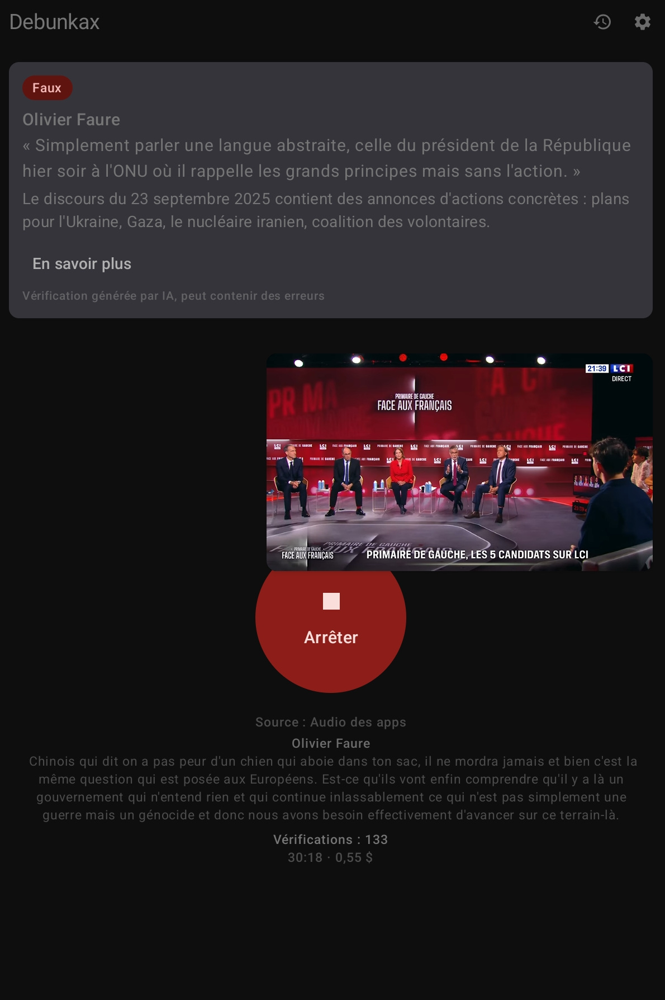
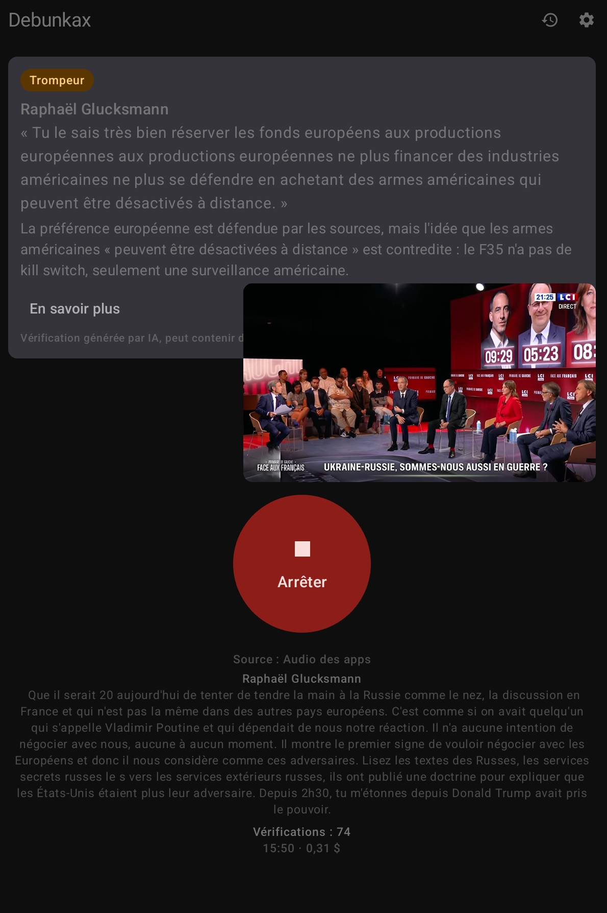
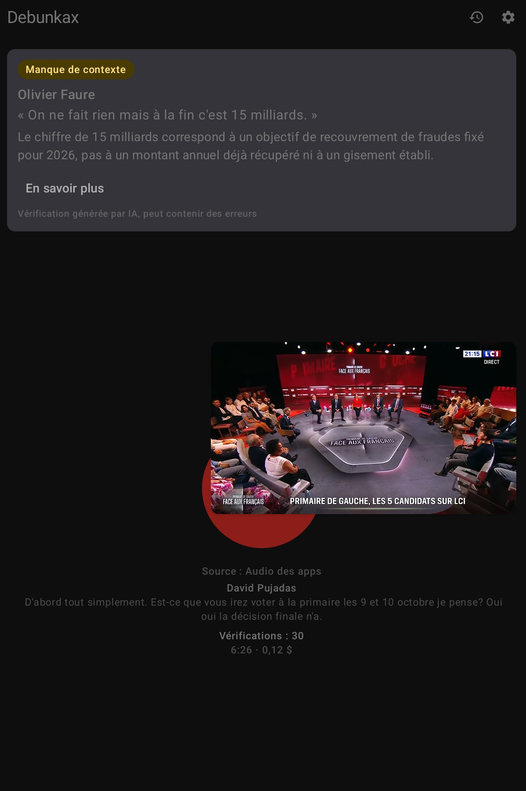

# Debunkax

Debunkax is a French-only Android app. While a Listening Session is running, it transcribes the French speech it hears (mostly TV political debates, shows and journalism), detects Claims on the device, checks them with the user's own AI provider, and raises Alerts for false, misleading or lacks-context Verdicts.

## Screenshots

<table>
  <tr>
    <td align="center"></td>
    <td align="center"></td>
    <td align="center"></td>
    <td align="center"></td>
    <td align="center"></td>
  </tr>
  <tr>
    <td align="center"><sub><b>false</b> Verdict</sub></td>
    <td align="center"><sub><b>misleading</b> Verdict</sub></td>
    <td align="center"><sub><b>lacks-context</b> Verdict</sub></td>
    <td align="center"><sub>History</sub></td>
    <td align="center"><sub>Claim detail</sub></td>
  </tr>
</table>

## How it works

Everything runs on a single phone. The pipeline:

```
audio (16 kHz mono)
  → speech-to-text (on device)
  → rolling transcript window (~30 s, memory only)
  → Claim filter (on device)
  → Speaker recognition (on device)
  → Check (user's OpenRouter key, searched on Trusted Sources)
  → Verdict
  → Alert (only for false / misleading / lacks-context)
  → History (Room; never audio or transcripts)
```

### 1. Start a Listening Session

The user presses the big button while the app is in the foreground and picks a source (ADR 0004):

- **Microphone** — the room (a TV debate), the default. The session stops if the app goes to the background.
- **Audio des apps** — this device's own media playback (YouTube, France.tv Pluzz…) captured through the `AudioPlaybackCapture` API. It carries the platform's per-session consent (system dialog, `mediaProjection` foreground service, red recording icon the user can revoke at any time) and keeps running in the background, since the video plays in another app.

Either source produces the same 16 kHz mono PCM stream, so the rest of the pipeline is identical.

### 2. Speech-to-text (on device)

- Primary: **ML Kit GenAI Speech Recognition** (fr-FR). On the tablet the app feeds ML Kit its own mic feed through a pipe.
- Fallback: **sherpa-onnx** streaming zipformer, downloaded once from its official GitHub release; used on emulators and unsupported devices.

Output consists of finals (complete utterances), split into sentences before the filter. Only a rolling window of about 30 s of transcript is kept in memory; it is the context sent to the AI. **Raw audio is discarded as soon as it is transcribed. Nothing is ever recorded.**

### 3. Claim filter (on device)

Each sentence goes through `TfidfClaimDetector` — TF-IDF + logistic regression in pure Kotlin, model in `assets/claim_model.json` (trained by `spikes/claims/`). It keeps factual-sounding assertions (Claims) and drops the rest, which is what keeps API costs down.

### 4. Speaker recognition (on device)

A speaker-recognition model compares the current audio window against **62 enrolled voice prints** (leaders, politicians, journalists) shipped in the app's assets. If the best match clears the threshold (0.45) with a 0.05 margin over the next-best, the Claim names that person; otherwise it is **"Orateur non identifié"**. A Speaker is never guessed from what was said (ADR 0003). The current Speaker's name is shown above the live transcript.

### 5. The Check (the only network call that carries user content)

For each accepted Claim, one **Check** is two requests to the user's own **OpenRouter** key — OpenRouter only, DeepSeek V4.1 Flash only (ADR 0005):

1. a search-free **pre-check**, a cheap sanity pass;
2. a **searched Check**, with **Exa** web search restricted to the **Trusted Source** allowlist (major national press — AFP, Le Monde, franceinfo, Libération, Le Figaro, BFM TV, France 24, RFI — plus fact-checking services and official sources: INSEE, Légifrance, Assemblée nationale, Sénat, Cour des comptes…).

For a second-person sentence from a recognised Speaker (« vous avez voté… »), the Check also gets a **probable addressee** (ADR 0006): a person named directly in the sentence or just before it, else the last other politician recognised by voice in the 30 s before the sentence (journalists skipped). If the addressee stays uncertain, the Verdict is unverifiable — never a guess.

The AI returns a **Verdict** — false, misleading, lacks context, unverifiable, or accurate — plus a short context and at least one source. If there is no connection or a key problem, the Claim becomes a **Pending Claim**: it is never checked in that session and never raises an Alert.

### 6. Alert policy

Only **false, misleading, or lacks-context** Verdicts raise an **Alert**: the Speaker, the sentence as heard, a short context, and a way to get more factual information. An Alert is easy to dismiss, and a newer one replaces the one on screen. "Unverifiable" and "accurate" never interrupt.

If the user asks for more, an **Explanation** — the deeper, sourced account of the Verdict — is generated on request only.

### 7. History

Room stores each checked Claim: date and time, Verdict, short context, sources, Speaker. It never contains audio or transcripts, and the user can clear it.

## Privacy

- **Never audio or transcripts on disk.** Only Claims, their Verdicts, context, Explanations, sources and timestamps (the History).
- **Mic sessions listen only in the foreground**, started by the user. No hidden background service, no listening on boot, screen kept awake during a session. App-audio sessions are the documented exception (ADR 0004).
- **Bring your own key**: OpenRouter (OAuth PKCE), stored encrypted in the Android Keystore, zero-data-retention requested where the provider supports it.
- **Nothing leaves the phone** except: Checks (Claim + transcript window) to the user's own provider; the launch-time update check against the public release page; and the one-time download of the sherpa-onnx speech model. No backend, no analytics, no crash reporting.
- **French only**: audio, UI and generated text.

## Stack

- Kotlin, Jetpack Compose, native Android. minSdk 31 (Android 12), target devices with about 6 GB of RAM or more.
- Distribution: signed APK, direct download (no Play Store yet).

## Code map

`app/src/main/java/app/debunkax/`:

- `domain/` — pure Kotlin model and rules: Claims, Verdicts, AlertPolicy, CheckPrompts, TrustedSources, TfidfClaimDetector, repository and engine interfaces
- `session/` — ListeningSession, the loop from speech to Check to Alert and History; the app-audio capture service
- `speech/` — ML Kit, sherpa-onnx, FallbackSpeechEngine, scripted and file demo engines
- `check/` — the OpenRouter client, and the model list
- `history/` — Room
- `keys/` — Tink key vault and OpenRouter PKCE
- `settings/` — DataStore
- `speaker/` — speaker recognition (voice prints, matching, the per-session timeline)
- `ui/` — Compose screens
- `update/` — release check
- `AppContainer.kt` — manual dependency wiring, debug demo modes and test overrides

`spikes/`: Python experiments behind the ADRs: `stt/` (speech-to-text accuracy), `claims/` (claim-filter dataset and training), `verdicts/` (Verdict golden set and bench), `speakers/` (voice clips, eval, and `export_prints.py`, which copies the model and voice prints into the app's assets — run it before building).

## Build and test

The [Makefile](Makefile) wraps the usual Android conventions (`make help` for usage):

```sh
make debug                    # debug APK (arm64 + x86_64)
make release                  # signed release APK (arm64 only; needs keystore.properties)
make release EMULATOR_ABI=1   # also include x86_64 (emulator smoke test)
make test                     # JVM unit tests (incl. Robolectric)
make connected-test           # instrumented Compose tests (DEVICE=<serial>)
make bench                    # the paid Verdict bench (spikes/verdicts/README.md)
make lint                     # Android Lint
make install DEVICE=...       # install the debug APK on a device
make run DEVICE=...           # install and launch
make clean
```

The equivalent Gradle commands, for reference:

- Export `JAVA_HOME=$(dirname $(dirname $(readlink -f /usr/bin/java)))` (JDK 17) before Gradle (the Makefile does this for you).
- `./gradlew testDebugUnitTest assembleDebug` — unit tests (JVM, Robolectric for Room) and the debug APK.
- `ANDROID_SERIAL=emulator-5554 ./gradlew connectedDebugAndroidTest` — instrumented Compose tests, using the test overrides in `AppContainer`.
- `./gradlew assembleRelease` — arm64-only. Add `-PemulatorAbi` to include x86_64. Signing reads `keystore.properties` (see `docs/release.md`).
- `./gradlew testDebugUnitTest --tests '*VerdictBench*' -Pbench` — the paid Verdict bench (`spikes/verdicts/README.md`).
- Debug-only switches in Réglages: "Mode démo" (scripted transcript and fake Verdicts) and "Démo audio réelle" (replays `files/demo.wav` through the speech engine).

## Documentation

- `CONTEXT.md` — the glossary of domain terms (Listening Session, Claim, Check, Verdict, Pending Claim, Alert, Explanation, History, Trusted Source). Use its terms exactly.
- `docs/STATUS.md` — current state: what is verified, what isn't, and the next step.
- `docs/adr/` — architectural decisions.
- `docs/possible-evolutions.md` — features deliberately left out of the first version.

## License

Debunkax is free software under the GNU General Public License, version 3 or (at your option) any later version. See `LICENSE`.

Not covered by that license: the excerpts of TV broadcasts in `spikes/` (the transcripts in `spikes/verdicts/` and the test fixtures) belong to their broadcasters and are quoted for research and evaluation. The voice prints in `app/src/main/assets/speakers/prints.json` are derived from public recordings of the people they name and are included only for speaker recognition.
